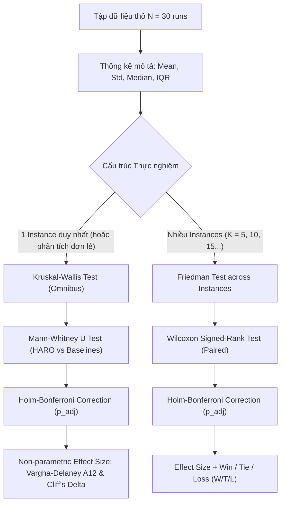

# EXPERIMENT RULEBOOK: QUY CHUẨN THỰC NGHIỆM TỐI ƯU HÓA METAHEURISTIC & ĐỐI SÁNH THỐNG KÊ

> **Tài liệu quy chuẩn bắt buộc (Mandatory Research Protocol)** dành cho các thực nghiệm tối ưu hóa mạng lưới quan trắc chất lượng không khí GIS bằng thuật toán đề xuất **HARO** và các thuật toán đối chứng **ARO, PSO, MVO, GA**.

---

## 1. NGUYÊN TẮC CỐT LÕI (CORE PRINCIPLES)

1. **Cấu trúc thực nghiệm đối kháng chuẩn tắc:**
   - **01 thuật toán đề xuất (Proposed algorithm):** HARO (Halo-enhanced Artificial Rabbits Optimization).
   - **$k-1$ thuật toán đối chứng (Baseline algorithms):** ARO gốc (Wang et al., 2022), PSO (Kennedy & Eberhart, 1995), MVO (Mirjalili et al., 2016), GA (Real-coded Genetic Algorithm).

2. **Quy mô mẫu lặp độc lập ($N = 30$):**
   - Mỗi thuật toán trên mỗi kịch bản / bài toán (instance) phải chạy chính xác **$N = 30$ lần độc lập**.
   - Tuyệt đối không tái sử dụng trạng thái ngẫu nhiên giữa các lần chạy.

3. **Tập Hạt giống Ngẫu nhiên Thống nhất (Deterministic Seed Suite):**
   - Bộ 30 lần chạy tương ứng với tập seed cố định: `seed = 1, 2, 3, ..., 30`.
   - Tất cả các thuật toán trên cùng một kịch bản phải chạy trên **cùng một tập seed** để đảm bảo tính công bằng và có thể ghép cặp (paired comparison).

4. **Ngân sách Đánh giá Hàm Mục tiêu Ngang bằng (Fair Computational Budget):**
   - Tất cả các thuật toán phải có cùng ngân sách đánh giá hàm mục tiêu:
     $$\text{FE} = N_{\text{pop}} \times T_{\text{iter}}$$
     *(Ví dụ: $N_{\text{pop}} = 30, T_{\text{iter}} = 150 \implies \text{FE} = 4,500$ evaluations).*

5. **Môi trường Thực thi Đồng nhất (Identical Hardware & OS Platform):**
   - Toàn bộ các lần chạy phải thực hiện trên cùng một máy trạm để thời gian thực thi (Runtime in seconds) có giá trị đối sánh tin cậy.

---

## 2. QUY CHUẨN BẢO TOÀN DỮ LIỆU THỰC NGHIỆM (RAW DATA PRESERVATION PROTOCOL)

> [!CAUTION]
> **TUYỆT ĐỐI KHÔNG ĐƯỢC** chỉ in ra hoặc lưu trữ các chỉ số tổng hợp cuối cùng (Mean, Std, Best). Bắt buộc phải lưu toàn bộ dữ liệu thô của từng lần chạy độc lập.

Mỗi kịch bản thực nghiệm phải tự động xuất ra tối thiểu **2 tệp dữ liệu lưu vết**:

### A. Tệp Kết quả Từng lần chạy (`raw_runs_results.csv`)
Gồm tối thiểu các trường dữ liệu:
- `instance`: Tên kịch bản (ví dụ: `Grid50x50_K5`, `HCMC_Real`).
- `algorithm`: Tên thuật toán (`HARO`, `ARO`, `PSO`, `MVO`, `GA`).
- `run_id`: Số thứ tự lần chạy (`1` đến `30`).
- `seed`: Giá trị hạt giống ngẫu nhiên (`1` đến `30`).
- `best_fitness`: Giá trị Fitness tốt nhất tìm được.
- `coverage_ratio`: Tỷ lệ bao phủ ô nhiễm thực tế ($[0.0, 1.0]$).
- `coverage_pct`: Tỷ lệ bao phủ phần trăm ($[0.0\%, 100.0\%]$).
- `penalty`: Giá trị hàm phạt vi phạm khoảng cách tối thiểu.
- `is_feasible`: Trạng thái khả thi ($True/False$).
- `runtime_seconds`: Thời gian chạy thực tế (giây).
- `best_coordinates`: Chuỗi JSON lưu danh sách $K$ tọa độ trạm tối ưu.

### B. Tệp Lịch sử Tiến hóa / Hội tụ (`convergence_traces.csv`)
Ghi nhận giá trị Fitness tốt nhất sau mỗi thế hệ $t \in [1, T]$ cho từng lần chạy:
- Cột: `[instance, algorithm, run_id, seed, iteration, best_so_far_fitness]`.
- Dữ liệu này dùng để phục hồi đường cong hội tụ (Convergence curve) bất cứ lúc nào.

---

## 3. QUY TRÌNH KIỂM ĐỊNH THỐNG KÊ (STATISTICAL ANALYSIS PIPELINE)

Thực hiện chuẩn hóa phân tích thống kê theo đúng 2 mô hình (Single-Instance vs Multi-Instance):

### A. Thống kê Mô tả (Descriptive Statistics)
- **Mean (Trung bình)** và **Std (Độ lệch chuẩn)**.
- **Median (Trung vị)** và **IQR (Khoảng tứ phân vị $IQR = Q_3 - Q_1$)**: Đây là các chỉ số vững (robust metrics) không bị ảnh hưởng bởi điểm ngoại lai (outliers), bắt buộc phải có cho dữ liệu metaheuristic.

### B. Kiểm định Không Tham số Tổng thể (Omnibus Non-Parametric Test)
- **Khi đánh giá trên 01 Instance:** Sử dụng kiểm định **Kruskal-Wallis $H$-test** để kiểm tra giả thuyết vô hiệu $H_0$ (tất cả các thuật toán có cùng phân phối hiệu năng). Nếu $p < 0.05$, bác bỏ $H_0$ và tiến hành kiểm định cặp.
- **Khi đánh giá trên nhiều Instances:** Sử dụng kiểm định **Friedman rank sum test** trên các giá trị trung bình/trung vị giữa các kịch bản.

### C. Kiểm định Cặp Hậu nghiệm (Post-hoc Pairwise Comparison)
- Thực hiện kiểm định giữa thuật toán đề xuất (HARO) với từng thuật toán đối chứng:
  - Trên 1 instance: Dùng **Mann-Whitney U test** (Wilcoxon rank-sum test độc lập).
  - Qua nhiều instances: Dùng **Wilcoxon signed-rank test** (ghép cặp theo từng kịch bản hoặc seed).
- **Kiểm soát Sai số Loại I bằng Hiệu chỉnh Holm-Bonferroni (Holm's Step-Down):**
  Sắp xếp các giá trị $p_{(1)} \le p_{(2)} \le \dots \le p_{(m)}$. Tại bước $i$, ngưỡng bác bỏ là:
  $$\alpha_i = \frac{\alpha}{m - i + 1}$$
  Nếu $p_{(i)} < \alpha_i$, kết luận có ý nghĩa thống kê thực sự.

### D. Đo lường Kích thước Hiệu ứng (Effect Size)
Bên cạnh giá trị $p$, bắt buộc phải báo cáo độ lớn của sự khác biệt:
1. **Vargha-Delaney $\hat{A}_{12}$:**
   $$\hat{A}_{12} = \frac{R_1 - \frac{n_1(n_1+1)}{2}}{n_1 n_2}$$
   - $\hat{A}_{12} = 0.5$: Không có sự khác biệt.
   - $\hat{A}_{12} > 0.5$: Thuật toán 1 (HARO) vượt trội hơn Thuật toán 2.
   - Ngưỡng đánh giá: Small ($\ge 0.56$), Medium ($\ge 0.64$), Large ($\ge 0.71$).
2. **Cliff's $\delta$:** $\delta = 2 \hat{A}_{12} - 1 \in [-1, 1]$.
3. **Thống kê Win / Tie / Loss (W/T/L):** Đếm số lần HARO Thắng (W), Hòa (T), Thua (L) ở mức ý nghĩa $\alpha = 0.05$.

---

## 4. QUY CHUẨN MÔ HÌNH HÓA TOÁN HỌC STEP 1 (END-TO-END ALIGNMENT)

Toàn bộ mã nguồn bài toán GIS phải bám sát 100% công thức toán học đã phê duyệt ở STEP 1:

1. **Mô hình Trường Nồng độ Gaussian 2D Đẳng hướng:**
   $$C(x, y) = \sum_{m=1}^{M_{\text{src}}} \frac{Q_m}{2\pi \sigma_m^2} \exp\left( - \frac{(x - x_m^{\text{src}})^2 + (y - y_m^{\text{src}})^2}{2\sigma_m^2} \right)$$
   *(hoặc dạng chuẩn $C_m(x,y) = Q_m \exp\left(-\frac{d_m^2}{2\sigma_m^2}\right)$).*

2. **Hàm Độ bao phủ Không gian Suy giảm Khoảng cách Liên tục (Continuous Distance Decay):**
   $$\text{Coverage}(x, y, S) = \max_{k=1..K} \exp\left( -\lambda \cdot d((x, y), s_k) \right)$$
   trong đó $\lambda = \frac{\ln(10)}{R_{\text{sens}}}$ để tại bán kính hiệu dụng $R_{\text{sens}}$, độ bao phủ còn 10%.

3. **Hàm Phạt Vi phạm Ràng buộc Khoảng cách Tối thiểu (Quadratic Penalty):**
   $$P(S) = \gamma \sum_{i=1}^{K-1}\sum_{j=i+1}^K \max\left(0, d_{\min} - d(s_i, s_j)\right)^2$$

4. **Hàm Fitness Tổng hợp:**
   $$\text{Fitness}(S) = \sum_{x=1}^W \sum_{y=1}^H C(x, y) \cdot \text{Coverage}(x, y, S) - P(S)$$
   *(Bài toán cực đại hóa $\text{Fitness}(S)$, hoặc nếu chuyển thành cực tiểu hóa: $\min \mathcal{L}(S) = - \text{Fitness}(S)$).*

5. **Tỷ lệ Bao phủ Chuẩn hóa (%):**
   $$\text{Coverage Ratio}(S) = \frac{\sum_{x=1}^W \sum_{y=1}^H C(x, y) \cdot \text{Coverage}(x, y, S)}{\sum_{x=1}^W \sum_{y=1}^H C(x, y)} \times 100\%$$

6. **Ánh xạ Rời rạc hóa (Snapping & Greedy Repair):**
   - Nghiệm tối ưu hóa trong $\mathbb{R}^{2K}$.
   - Trước khi tính Fitness: Chiếu nghiệm làm tròn $\tilde{s}_k = (\text{round}(x_k), \text{round}(y_k))$.
   - Áp dụng Greedy Repair tuần tự để bảo đảm không trùng trạm và $d(\tilde{s}_i, \tilde{s}_j) \ge d_{\min}$.

